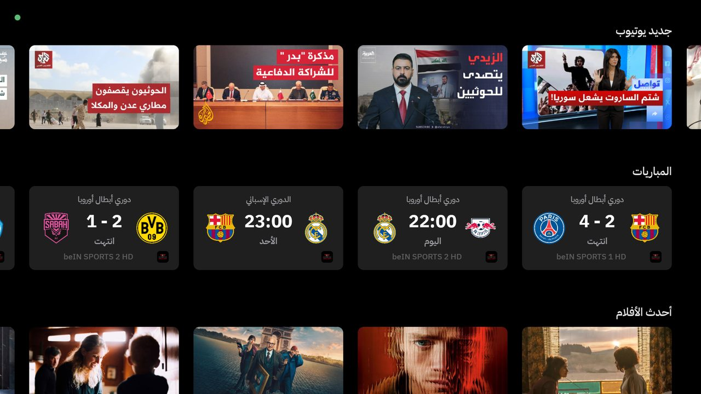
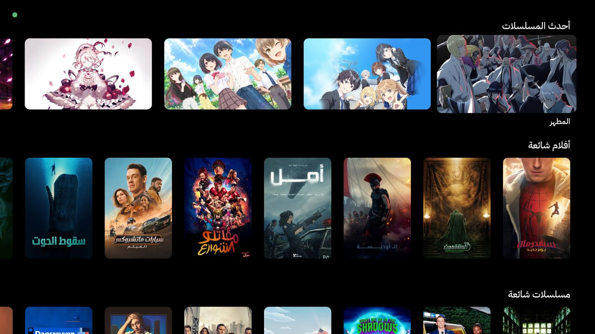
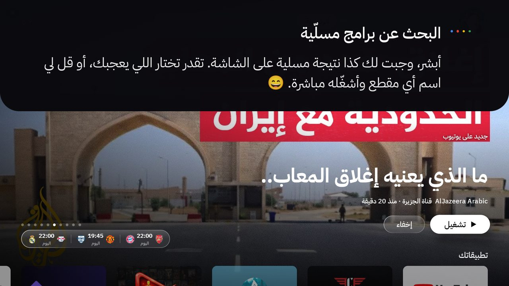
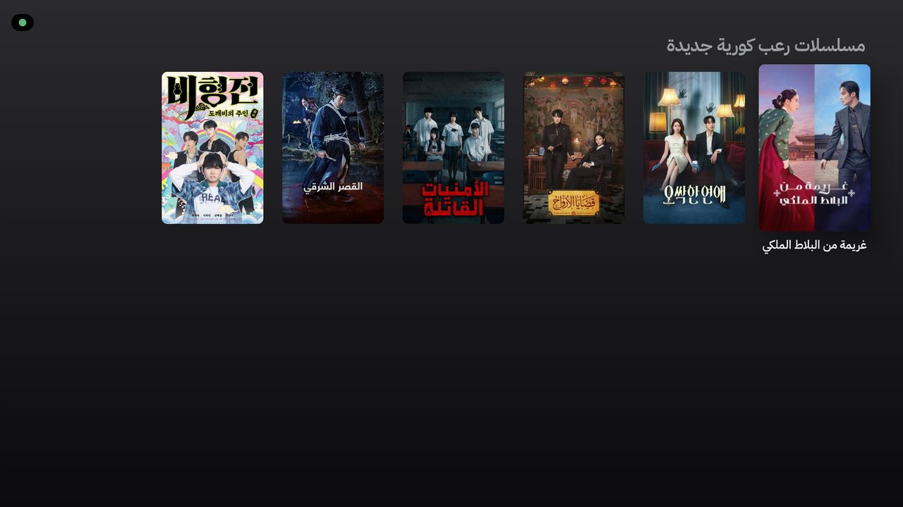
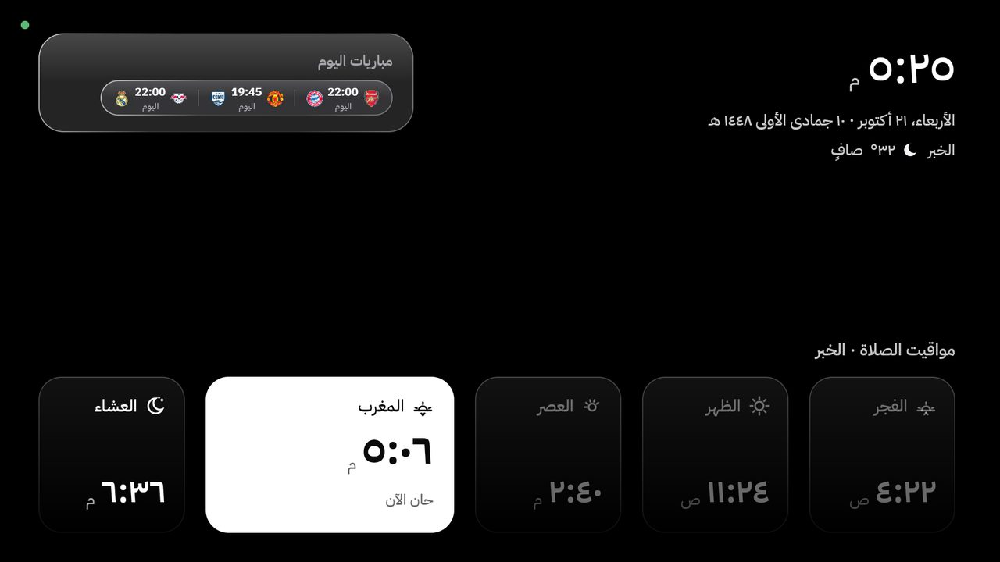
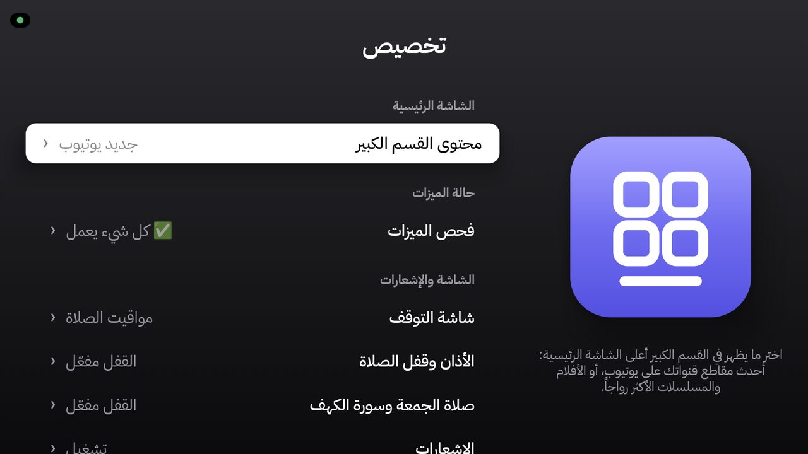
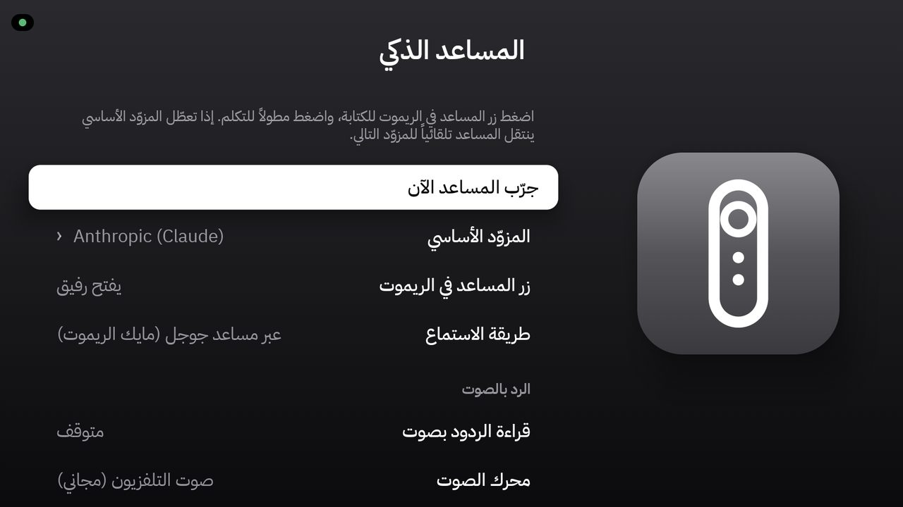

# TvHome — a smart Arabic home screen for Android TV

> 🇸🇦 النسخة العربية: [README.ar.md](README.ar.md) · 📖 Illustrated guide: [docs/guide.html](docs/guide.html) · 🤖 Install with an AI agent: [install.md](install.md)

**TvHome** replaces the launcher of an Android TV / Google TV set with a complete Arabic (right-to-left)
home system: a clean tvOS-style home screen with fresh content, **Rafiq** (an AI voice assistant that
can actually operate the TV), prayer times with adhan and a prayer lock, Friday (Jumu'ah) mode with
Surah Al-Kahf, live football with reminders, a prayer-times screensaver, and system-wide tools.
Native Kotlin + Jetpack Compose, tuned for low-memory TVs (1.8 GB).



| | |
|---|---|
|  |  |
|  |  |
|  |  |
|  |  |

---

## Features

| Area | What it does |
|---|---|
| **Home** | Full-screen hero (newest YouTube uploads from your channels or TMDB titles), *New on YouTube*, *Matches*, **Latest Movies** and **Latest Episodes** (refreshed every 15 min and on return to Home — new episodes and anime of the day show "Season X · Episode Y · Today"), popular rows and your apps. |
| **Rafiq assistant** | Press the remote's assistant/mic button and talk. Google's own engine does the listening (the remote mic only reaches Google), its screen is hidden, and Rafiq answers in Saudi Arabic with text + voice. Anthropic Claude → Experiential Labs → Gemini, with automatic fallback. |
| **Rafiq's abilities** | Search the whole film/series/anime library by genre, country (Korean, Japanese, anime, Asian, Turkish, Arabic, Gulf…), era, rating or "something like X" and show the picks as posters · family / no-scenes content filter on every suggestion · open a title's page · play any movie or episode in **Stremio** ("last episode", "season 2 episode 5"…) and auto-pick a healthy 1080p stream · YouTube: latest video of a channel, latest episode of a *show* on a channel, live channels, search & play · Quran surahs · matches & opening a match on Casper Flix · weather · prayer times · volume / playback / navigation · reading the screen ("what's this?") · web search. Instant commands (volume, open app, time…) answer in ~0.3 s without any AI call. |
| **Prayer** | Umm al-Qura times (Al Khobar by default, configurable), adhan audio, optional **prayer lock** from adhan until iqama (per-prayer iqama offsets), emergency exit by holding Back 5 s, optional standby. |
| **Friday** | Jumu'ah lock window, Surah Al-Kahf hero on Friday with 3 reciters (Alafasy, Al-Muaiqly, Al-Sudais). |
| **Football** | Fixtures and live scores (ESPN / FilGoal / FotMob), followed leagues and clubs, live refresh every 15 s, match page with line-ups, reminders 15/30/60 min before followed clubs play, one-press **Watch on Casper Flix** that tunes straight to the channel. |
| **Screensaver** | Prayer-times dashboard over video or photos with weather and a rotating card; Aerial videos. |
| **System tools** | Control Center (hold Home), App Switcher (double-press Home), notices, a health check with one-press fixes, Search with a linear keyboard and title pages (trailer, Stremio). |
| **Light on the TV** | Image caches trimmed under memory pressure, disk caches, on-demand screen reading (never left on), measured jank ≈ 2 % on a 1.8 GB TCL Google TV. |

---

## Requirements

| Item | Note |
|---|---|
| TV | Android TV / Google TV, Android 8.0+ (minSdk 26). Developed on a TCL Google TV (Android 12, 1.8 GB). |
| Computer | macOS, Linux or Windows with **JDK 21**, **Android SDK** (platform 36 + build-tools) and **adb** |
| TMDB | Free *API Read Access Token* — <https://www.themoviedb.org/settings/api> (required) |
| AI key(s) | At least one: Anthropic, Experiential Labs or Google Gemini (only for Rafiq) |
| Optional apps on the TV | Stremio (with your own add-ons), Casper Flix, YouTube |

---

## Install

The fastest way: open this folder in an AI coding agent (Claude Code, Cursor, Codex…) and say
**"follow install.md"** — it asks what you need and does every step with you.
Manual steps:

### 1 · Configure

```bash
cp local.properties.example local.properties   # then fill in sdk.dir, TMDB_READ_TOKEN and your AI key(s)
```

City for prayer times: `app/src/main/java/com/moath/tvhome/prayer/PrayerTimes.kt` (`PrayerConfig`);
weather cities: `dashboard/DashboardData.kt` (`CITIES`); the assistant's home city: the system prompt in
`assistant/AssistantEngine.kt`.

### 2 · Build (release)

```bash
./gradlew :app:testReleaseUnitTest :app:assembleRelease
# → app/build/outputs/apk/release/app-release.apk
```

Always install the **release** build (R8, signed with the debug key) — a debug Compose build is visibly
slower on TV hardware. On a busy computer: `nice -n 19 ./gradlew --no-daemon --max-workers=1 …`.

### 3 · Install on the TV

On the TV: *Settings → System → About → press "Build" 7 times*, then *Developer options → USB debugging*
(and *Network debugging* if offered). Find the TV's IP in *Settings → Network*.

```bash
adb connect <tv-ip>:5555                       # accept the prompt on the TV
adb install -r app/build/outputs/apk/release/app-release.apk
TV=<tv-ip>:5555 ./scripts/after-install.sh     # permissions + system service (run after every update)
TV=<tv-ip>:5555 ./scripts/set-home.sh          # make TvHome the Home screen + its screensaver
```

### 4 · Optional

```bash
# YouTube channels for "New on YouTube" (channel ids or @handles, one per line, or a Takeout subscriptions.csv)
adb push youtube_channels.txt /sdcard/Android/data/com.moath.tvhome/files/
# Keep the clock right after power cuts (boxes without RTC)
adb shell settings put global ntp_server 162.159.200.123
```

- **Casper Flix channel tuning / Stremio stream picking** press keys through the TV's own adb
  (127.0.0.1:5555). The first time, the TV asks "Allow debugging?" — tick *Always allow*.
- **Disabling pre-installed apps** is never done without the owner's approval and only with
  `pm disable-user --user 0` (reversible). Every disabled package goes into `scripts/disabled-packages.txt`.

### Undo everything

```bash
TV=<tv-ip>:5555 ./scripts/restore.sh            # add --uninstall to remove TvHome too
```

---

## Remote control

| Button | Action |
|---|---|
| Assistant / mic | Rafiq listens (through Google) and answers |
| Home (hold) | Control Center |
| Home (double press) | App Switcher |
| Back (hold 5 s) on the prayer lock | Emergency exit (the bar appears after 2 s) |
| OK on the screensaver | Dismiss |

---

## Project layout

```
app/src/main/java/com/moath/tvhome/
├── home/        Home rows, caches, content repository (TMDB + YouTube + matches)
├── assistant/   Rafiq: engine, providers, tools, library search, Stremio, YouTube, speech
├── system/      Accessibility service: Google-ear, Rafiq plate, Control Center, App Switcher, tuners
├── prayer/      Prayer times, adhan, prayer lock         quran/   Quran player, Al-Kahf
├── sports/      Matches, reminders, Casper Flix          dashboard/ prayer screensaver
├── search/      Search, title pages, assistant picks     settings/  Settings app
├── tmdb/ youtube/ aerial/ screensaver/ health/ notify/ design/ prefs/
scripts/         after-install.sh · set-home.sh · restore.sh · disabled-packages.txt
docs/            guide.html (illustrated guide) · screenshots/
```

Developer hooks for testing on the TV (`notify/DevHooks.kt`), e.g.
`adb shell am broadcast -p com.moath.tvhome -a com.moath.tvhome.DEV_PLATE --es text "افتح يوتيوب"` simulates a spoken request.

---

## Troubleshooting

| Problem | Fix |
|---|---|
| Control Center / Rafiq don't respond after an update | Run `scripts/after-install.sh` again (TCL TVs block the service until `APP_AUTO_START` is allowed). |
| `adb: No route to host` while the TV is on | `adb kill-server && adb start-server && adb connect <tv-ip>:5555` |
| Rafiq says it needs a key | Add a key to `local.properties` and rebuild. |
| Prayer card hidden | The clock isn't set yet (year < 2025) — see the NTP tip above. |

---

Not affiliated with Apple, Google, YouTube, Stremio, TMDB or any other service named here; their names
are trademarks of their owners. You are responsible for the add-ons and content you use.

**© 2026 Moath Al-Hakeem — made with ♥️**
